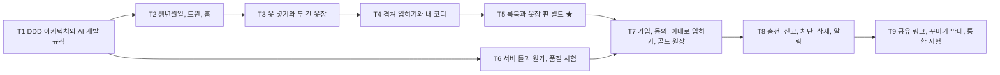

# NUNO 개발 로드맵

원본은 기획 작업 폴더의 「NUNO 로드맵 v1」(2026-11-23) 1절에서 3절이다.
Task 상태는 이 파일에서 고친다. DoD 문장을 바꾸려면 먼저 묻는다.
상태 값은 「대기」, 「진행 중」, 「완료」 셋이다.

## 1. 한눈에

> 아홉 Task 를 18주 동안 차례로 끝내는 계획이다(실측 없는 추정).
> T5 가 끝나면 서버 없이 동작하는 「옷장 판」 을 초대한 사람에게 줄 수 있다.
> 생성 원가와 품질은 T6 에서 잰다. 기준에 못 미쳐도 「이대로 입히기」 는 켠 채 공개한다.

| 진행 순서 | 번호 | Task | 상태 | subtask 수 | 예상 주 | 먼저 끝나야 하는 Task |
| --- | --- | --- | --- | --- | --- | --- |
| 1 | T1 | 모바일 앱 DDD 아키텍처와 AI 개발 규칙 세우기 | 완료 | 5 | 1 | 없음 |
| 2 | T2 | 생년월일 입력, 트윈 여섯 고르기, 홈 무대 | 완료 | 4 | 1 | T1 |
| 3 | T3 | 옷 사진 넣기와 「내 옷」, 「담은 옷」 두 칸 옷장 | 완료 | 5 | 2 | T2 |
| 4 | T6 | 서버 틀, 생성 공급사 어댑터, 원가와 품질 시험 | 진행 중 | 4 | 2 | T1 |
| 5 | T4 | 트윈에 옷 겹쳐 입히기와 「내 코디」 저장 | 완료 | 5 | 2 | T3 |
| 6 | T5 ★ | 첫 코디 룩북 저장과 「옷장 판」 시험 빌드 | 완료 | 4 | 1 | T4 |
| 7 | T7 | 가입, 첫 사용 동의, 「이대로 입히기」, 골드 원장 | 진행 중 | 5 | 3 | T5, T6-1, T6-2 |
| 8 | T8 | 골드 충전, 신고와 차단, 계정 삭제, 알림 | 대기 | 7 | 3 | T7 |
| 9 | T9 | 공유 링크, 트윈 꾸미기 막대, 출시 전 통합 시험 | 대기 | 6 | 3 | T8 |

- ★ T5 의 「옷장 판」 이 첫 공개 가능한 빌드다. 초대한 사람에게 TestFlight 로 준다.
- 👗 참가자 5명이 「옷장 판」 을 2주 쓰는 동안 다음 Task 를 한다.
- 👗 5명 중 2명이 두 칸 옷이 함께 든 코디를 「내 코디」 에 저장하지 않으면(G3B-1) 하던 Task 를 멈춘다. 그 뒤 옷 넣기를 1주 고친다.
- 👗 2주 사용 확인 동안에는 결과와 관계없는 서버 기반 일(가입, 운영 명령, worker)을 먼저 한다. 옷 넣기 방식에 기대는 생성 기능은 확인을 마친 뒤 만든다.
- 🧮 합은 18주, 234시간이다. 그중 코드는 192시간이다.
- 🧮 서버를 직접 만들어 T6~T9 의 작업 시간이 적어도 12시간 늘어난다(추정). T6-1 을 마친 뒤 실제 걸린 시간으로 다시 계산한다.
- 🗓️ 11/23 에 시작해 연말(12/28~1/3)과 설(2/6~2/9) 주를 비우면 달력으로 약 20주다.
- 🧩 T1~T5 는 가입 없이 휴대폰 안에서 끝난다. T6~T9 는 서버를 쓴다.
- 🔁 T6 은 T1 만 끝나면 시작할 수 있다. 생성 원가와 품질을 일찍 알도록 T3 다음, T4 앞에 한다.
- 🔁 진행 순서는 T1, T2, T3, T6, T4, T5, T7, T8, T9 이다. 「옷장 판」 은 작업 9주 끝에 나온다.
- 🔁 T7 은 T5 와 T6-1, T6-2(서버 틀, 가짜 공급사)가 끝나면 시작한다. 실제 공급사 연결은 T6-4 에서 모델을 고른 뒤에 한다.
- 🚀 T9 가 끝나면 1차 출시 개발이 끝난다. 실제 공개는 비공개 시험, 출시 판정, App Store 심사 승인 뒤에 한다.
- 🚀 출시 판정은 개발 계획의 관문 5(G5-1~G5-5)로 한다. 공개 4주 뒤 2차 출시 기능을 열지는 관문 6(G6)으로 정한다.
- 🚀 관문 5 의 생성 품질 숫자는 기록하지만 공개를 막는 조건이 아니다.

---

## 2. 작업하는 법

- 📝 Task 를 시작하면 저장소 `docs/plans/plan_[taskID].md` 에 개발 계획을 쓴다(예: `plan_T1.md`).
- 🔍 계획을 여러 관점으로 리뷰하고, 고칠 곳이 나오면 계획부터 고친다.
- 🛠️ 고친 계획대로 subtask 하나씩 구현한다. subtask 하나는 PR 하나에서 셋이다.
- 🛠️ PR 은 100~300줄 안팎으로 나누고, 나눈 단위를 plan 파일 subtask 순서에 적는다.
- 👆 Expo 웹을 브라우저로 띄우고 사용자처럼 직접 눌러 DoD 를 하나씩 판정한다.
- 🔁 통과하지 못한 DoD 가 있으면 고치고 다시 눌러 본다. DoD 가 전부 통과해야 Task 가 끝난다.
- ✅ 「[명령] CI 의 `pnpm verify` 가 통과한다」 는 따로 적지 않아도 모든 Task 의 DoD 다.
- 🔁 T2 부터 각 Task 는 그 Task 의 주 흐름 하나를 웹 e2e 시험에 더한다.
- 🔁 앞 Task 의 e2e 가 깨지면 그 Task 는 끝나지 않는다.
- 🏷️ 꼬리표: [웹화면] 브라우저, [명령] 터미널이다.
- 🏷️ [DB] 는 기기 저장소면 개발 빌드의 「저장소 보기」 화면으로 판정한다. 서버면 로컬 Postgres SQL 조회로 판정한다.
- 🏷️ [iOS] 는 Xcode 설치 뒤 아이폰이나 시뮬레이터에서 판정한다.
- 🏷️ [사람] 은 기획자나 평가자가 판정한다. AI 는 판정 자료를 만들어 두고 다음 일을 한다.
- ⏸️ Xcode 가 없을 때 [iOS] DoD 는 plan 파일에 「환경 없음」 으로 적는다.
- ⏸️ 「환경 없음」 인 [iOS] DoD 와 [사람] DoD 는 Task 완료 판정에서 뺀다.
- ⏸️ 뺀 DoD 는 `docs/roadmap.md` 의 「iOS 와 사람 확인 대기」 목록에 모은다.
- ⏸️ Xcode 를 설치한 주에 밀린 [iOS] DoD 를 Task 순서대로 판정한다.
- ⏸️ 기획자가 1차 출시에서 끄기로 정한 기능은 성공 흐름 DoD 대신 꺼진 상태를 판정한다. 버튼이 눌리지 않고 API 가 거절하는지 본다.
- ⏸️ 뺀 성공 흐름 DoD 와 그 까닭은 plan 파일에 적는다. 안전, 권한, 골드 보호 DoD 는 빼지 않는다.
- ⏸️ 키나 환경이 있어야 하는 [명령] DoD 는 지금 할 수 있는 부분을 먼저 판정하고, 남은 조건을 plan 파일에 나눠 적는다.
- 🔢 DoD 끝 괄호의 C 번호는 PRD v10 확인 항목이다. S 번호와 G 번호는 개발 계획 v7 색인의 확인 항목이다.
- 🔢 「결정 D21」 처럼 「결정」 을 붙인 번호는 개발 계획 v7 「정할 것」 표의 결정 번호다.
- 🔢 plan 파일의 DoD 번호(D1, D2 …)는 「결정」 을 붙이지 않는다. 두 번호는 서로 관계없다.
- 🔢 C, S, G 번호와 「결정 D」 번호의 원문(PRD v10, 개발 계획 v7)은 공개하지 않는 기획 작업 폴더에 있다.
- 🔢 그 폴더의 경로는 세션 인계 문서에 있다.
- ✅ DoD 판정은 plan 파일 표에만 적고, 로드맵은 Task 상태 칸만 고친다.

**처음 나오는 말**

- 누끼: 옷 사진에서 배경을 지우고 옷만 따낸 그림.
- 「이대로 입히기」: 고른 옷을 AI 로 트윈에 입힌 정면 사진 1장을 받는 유료 기능.
- 「옷장 판」: T2~T5 기능만 넣어 서버와 가입 없이 휴대폰 안에서 쓰는 첫 빌드.
- 2차 출시: 1차 출시 뒤로 미룬 기능을 하나씩 여는 단계.
- 골드: 앱 안 재화. 1골드는 100원이다.
- 정상 사진당 원가: 불합격 항목에 걸리지 않은 사진 한 장을 얻는 데 든 돈.
- 포트와 어댑터: 구현을 바꿔 끼우는 연결 자리와, 그 자리에 꽂는 실제 구현.
- API 서버: 앱이 부르는 하나뿐인 서버다. 로그인, 생성 요청, 결제 확인을 받아 서버 DB 를 읽고 쓴다.
- 개발 서버: 개발 기간에만 쓰는 서버와 DB 다. DB 는 RDS Postgres 18 이고, 시험 계정과 시험 자료만 넣는다.
- 로컬 API 서버: 개발 PC 에서 띄운 API 서버와 worker 다. `pnpm api:rds` 로 띄우면 개발 서버의 DB 에 붙는다.
- 출시용 서버: 실제 사용자가 쓰는 API 서버와 DB 다. 둘 곳은 아직 정하지 않았다.
- 골드 묶기: 생성을 접수할 때 4골드를 잔액에서 빼 그 작업 몫으로 잡아 두는 처리다. 완성되면 차감을 확정하고, 실패하면 돌려준다.
- 예약 작업: 정해진 시각마다 서버가 스스로 실행하는 작업이다. 멈춘 생성 작업을 정리하고 지울 파일을 지운다.

---

## 3. Task

### T1. 모바일 앱 DDD 아키텍처와 AI 개발 규칙 세우기

- 📌 상태: 완료 (D20 은 「iOS 와 사람 확인 대기」)
- 🎯 목표: AI 가 같은 규칙으로 기능을 반복해 더하고 고칠 수 있는 저장소를 세운다.
- 👤 개발자가 할 수 있게 되는 것: `pnpm web` 으로 빈 앱을 띄운다. 규칙을 어기면 검사가 막는다.
- 📍 저장소: github.com/96Hong2/NUNO

**subtask**

- T1-1. 지시 파일과 색인된 짧은 룰 쓰기
  - 루트 `AGENTS.md` 를 정본으로 두고, `CLAUDE.md` 는 첫 줄 `@AGENTS.md` 와 작업 루프 한 줄로 200자 내외로 쓴다.
  - `.claude/rules/` 에 경로별 룰을 `paths:` 와 함께 두고, 룰 목록 색인 한 장을 둔다. `GLOSSARY.md` 에 화면에 보이는 이름과 코드 이름의 짝을 적는다.
  - 로드맵의 Task, subtask, DoD 를 `docs/roadmap.md` 에 옮기고 Task 마다 상태 칸을 둔다.
  - 공개 저장소라서 PRD 원문과 기획자 할 일 표는 옮기지 않는다. `docs/adr/` 폴더와 첫 ADR 을 둔다.
- T1-2. 경계 컨텍스트별 패키지와 계층 틀 만들기
  - 컨텍스트 지도를 `AGENTS.md` 의 「무엇을 바꾸려면 어디를 고치나」 표에 적는다.
  - `pnpm new:context` 명령은 `packages/<컨텍스트>/` 아래에 `src/domain`, `src/application`, `src/index.ts` 틀을 만든다.
  - 이 명령으로 첫 컨텍스트 `packages/twin` 을 만든다.
  - 패키지마다 `package.json` 의 `exports` 를 `src/index.ts` 하나로 닫는다.
  - 도메인이 인자로 받는 시계 포트와 ID 포트를 둔다. 고정 시계와 한국 시간대 헬퍼 하나를 함께 둔다.
- T1-3. 기계로 막는 검사 세우기
  - 타입 검사, ESLint, dependency-cruiser 경계 검사, 단위 시험을 `pnpm verify:fast` 로 묶는다.
  - GitHub Actions 에 `pnpm verify` 를 필수 검사로 걸고, main 은 PR 과 squash 로만 받게 보호한다.
- T1-4. Claude Code 훅 셋과 작업 루프 스킬 연결하기
  - PreToolUse 는 보호 경로 편집, `--no-verify`, 기존 시험 파일 고치기를 막는다.
  - PreToolUse 훅에 `"onFailure": "block"` 을 단다. 훅의 검사 루트는 `input.cwd` 의 git 최상위로 잡는다.
  - PostToolUse 는 고친 파일 하나만 포맷하고 그 파일 하나만 린트한다.
  - Stop 은 `pnpm verify:fast` 를 돌린다. 전역 `task-dod-loop` 스킬을 `AGENTS.md` 의 작업 루프 줄에서 가리킨다.
  - 스킬이 부르는 저장소 명령(`pnpm web`, `pnpm verify:fast`, `pnpm e2e`)과 plan 틀 경로를 저장소에 맞춘다.
- T1-5. Expo 웹으로 띄우는 빈 셸 만들기
  - Expo SDK 58, Expo Router 로 하단 「홈」, 「피팅룸」, 「마이」 와 피팅룸 위쪽 네 칸을 만든다.
  - 앱은 `apps/mobile` 에 둔다. 기기 저장소 포트와 웹 어댑터를 두고, 개발 빌드에만 보이는 「저장소 보기」 화면을 만든다.
  - 단위 시험용으로 Node 내장 `node:sqlite` 어댑터를 짝으로 둔다. 옮기기 함수 시험은 이 어댑터로 실행한다.
  - Playwright 로 Expo 웹을 띄워 하단 세 탭을 누르는 e2e 시험 하나를 `pnpm e2e` 로 건다.
  - `.claude/launch.json` 에 Expo 웹 실행 설정을 넣어 Claude 브라우저 창에서 바로 열리게 한다.

**DoD**

- [명령] `pnpm install` 뒤 `pnpm verify:fast` 가 타입 검사, 린트, 경계 검사, 단위 시험을 실행하고 통과한다.
- [명령] `packages/twin` 도메인 파일에 `react-native` import 를 넣으면 경계 검사가 실패한다. 실패 문구에 고치는 법이 한 문장 있다.
- [명령] 같은 도메인 파일에 `Date.now()`, `Math.random()`, `fetch` 를 넣으면 린트가 실패한다.
- [명령] 앱 코드가 `packages/twin` 의 `src/domain` 안쪽 경로를 import 하면 타입 검사나 경계 검사가 실패한다.
- [명령] 시험 파일에 `.only`, `.skip`, 단언 없는 시험 중 하나를 넣으면 린트가 실패한다.
- [명령] `pnpm new:context wardrobe` 를 실행하면 세 계층 틀이 생긴다. 그 뒤에도 `pnpm verify:fast` 가 그대로 통과한다.
- [명령] 룰 색인에 없는 `.claude/rules/*.md` 파일이 있거나 `paths:` 가 빠지면 `pnpm verify:fast` 가 실패한다.
- [명령] `AGENTS.md` 의 작업 루프 줄이 전역 `task-dod-loop` 스킬을 가리키고, 새 세션의 스킬 목록에 그 스킬이 보인다.
- [명령] 일부러 넣은 타입 오류 하나를 Stop 훅이 막고 이유를 보인다. 이 확인은 한 번만 한다.
- [명령] Claude 가 `git commit --no-verify` 를 부르면 PreToolUse 훅이 막는다.
- [명령] PR 하나가 CI `pnpm verify` 를 통과해 squash 로 머지된다.
- [명령] `gh api repos/96Hong2/NUNO/branches/main/protection` 응답에 필수 검사 `verify` 와 관리자 우회 금지가 있다.
- [웹화면] Claude 브라우저 창에서 `.claude/launch.json` 의 이름으로 앱이 열린다. `pnpm e2e` 가 통과한다.
- [명령] 새 세션 `/context` 에 루트 `CLAUDE.md` 가 보이고, 터미널 Loaded 줄에 `apps/mobile/CLAUDE.md` 가 보인다.
- [명령] `wc -m CLAUDE.md` 가 150~250 이다. 저장소에 `CLAUDE.local.md` 가 없고, Stop 훅에 `stop_hook_active` 확인이 없다.
- [웹화면] `pnpm web` 으로 연 브라우저에서 하단 「홈」, 「피팅룸」, 「마이」 를 누르면 머리글에 그 탭 이름이 보이는 빈 화면이 열린다. 하단에 「탐색」 과 「찜」 은 없다.
- [웹화면] 「피팅룸」 위쪽 「코디」, 「옷장」, 「트윈」, 「룩북」 칸을 누르면 그 칸의 빈 화면이 열린다. 「스토어」 칸은 없다.
- [웹화면] 개발 빌드에서 「저장소 보기」 를 열면 지금 쓰는 기기 저장소 어댑터 이름이 보인다. 이름은 expo-sqlite 나 wa-sqlite 다. 시험으로 쓴 값 한 줄도 보인다. 새로고침 뒤에도 그 값이 남는다.
- [명령] `plan_T1.md` 에 expo-sqlite 웹 읽기 쓰기 결과와 고른 웹 어댑터가 있다. Skia 웹 빌드 결과도 있다.
- [iOS] Xcode 설치 뒤 iOS 시뮬레이터에 같은 빈 셸이 뜬다.

**기술 검토를 함께 하는 subtask**

- 🧪 T1-5 에서 expo-sqlite 가 Expo 웹에서 읽고 쓰는지 2시간 안에 확인한다.
- ↩️ 웹에서 안 되면 같은 SQL 을 그대로 실행하는 wa-sqlite 나 sql.js 어댑터를 꽂는다. iOS 는 SQLite 그대로다.
- ↩️ 웹에서도 고유 색인과 검사 제약이 동작해야 웹의 [DB] DoD 판정을 iOS 판정과 같게 볼 수 있다.
- 🧪 T1-5 에서 Skia 와 Reanimated 가 웹 빌드를 깨지 않는지 본다. 깨면 SDK 57 로 내리고 판 번호를 고정한다.

**예상 시간**: 1주, 13시간(코드 11시간, 사람 일 2시간)

---

### T2. 생년월일 입력, 트윈 여섯 고르기, 홈 무대

- 📌 상태: 완료 (D13 은 「iOS 와 사람 확인 대기」)
- 🎯 목표: 처음 켠 사용자가 생년월일, 트윈, 스타일을 고르고 홈 무대에 그 트윈이 서게 한다.
- 👤 사용자가 할 수 있게 되는 것: 트윈 여섯 가운데 하나를 고르고, 홈의 「트윈 바꾸기」 에서 다시 고른다.

**subtask**

- T2-1. 기기 저장 형식의 판 번호와 「생년월일을 알려 주세요」 화면
  - 기기 저장 형식에 판 번호와, 옛 판 자료를 새 판으로 옮기는 함수(마이그레이션)를 둔다.
  - 생년월일은 날짜로 저장만 하고 프로필에 보이지 않는다.
- T2-2. 프리셋 트윈 여섯을 설치 파일에 넣고 「옷을 입어 볼 트윈을 골라 주세요」 화면 만들기
  - 실사 유나, 하린, 세린과 인형 모아, 루루, 노엘의 그림, 마스크, 얼굴 기준점 478개, 몸 기준점 33개를 넣는다.
- T2-3. 「좋아하는 스타일을 골라 주세요」 화면, 온보딩 건너뛰기, 마이 프로필
  - 첫 단계는 왼쪽 위 X, 다음 단계부터는 「건너뛰기」 로 홈에 간다. 마이에는 이름과 스타일 태그만 둔다.
- T2-4. 홈 무대, 「트윈 바꾸기」 시트, 홈 시트 「최근 저장한 룩」, 「최근 넣은 옷」 탭의 빈 상태, 처음 둘러보기
  - 홈 무대는 트윈마다 고정된 기본 코디 완성 사진이다. 홈 시트 두 탭은 틀과 빈 상태만 만든다.

**DoD**

- [웹화면] 저장소가 빈 브라우저로 열면 「생년월일을 알려 주세요」 가 뜬다. 날짜가 골라져 있어 「다음」 이 바로 눌린다. (S1-1)
- [웹화면] 위 화면은 새로고침하면 다시 뜨지 않는다. 마이 프로필에 생년월일이 보이지 않는다. (S1-1, S1-2)
- [웹화면] 트윈 고르기의 아래 버튼은 고르기 전 회색 「트윈을 골라 주세요」 다. 하린 카드를 누르면 「하린으로 시작」 으로 바뀐다. (C1)
- [웹화면] 「실사」 와 「인형」 을 바꿔 가며 보면 트윈 카드가 모두 여섯 장이다. (S1-3)
- [웹화면] 트윈 고르기의 왼쪽 위 X 를 누르면 홈으로 간다. 홈 무대에는 기본 트윈(plan_T2 에서 정함)의 기본 코디 사진이 선다. (C6)
- [웹화면] 둘째 단계 오른쪽 위 「건너뛰기」 를 누르면 홈으로 가고, 홈 무대에 첫 단계에서 고른 트윈이 선다. (C6)
- [웹화면] 홈 무대에 고른 트윈의 기본 코디 완성 사진이 흰 바탕 위에 선다. (C7)
- [웹화면] 「트윈 바꾸기」 시트에서 세린을 고르면 홈 무대가 세린의 기본 코디 사진으로 바뀐다. (S1-5)
- [웹화면] 홈 머리글에 종 버튼이 있고 장바구니, 메시지, 검색창은 없다. 홈 시트 두 탭에 빈 상태 문구가 보인다. (S1-6, S1-7)
- [DB] 「저장소 보기」 화면에 판 번호, 생년월일, 트윈 ID, 스타일 태그가 보인다. 새로고침 뒤에도 같다. (S1-4)
- [웹화면] 온보딩을 건너뛰고 홈에 처음 오면 처음 둘러보기가 뜬다. 끝까지 넘기거나 닫으면 새로고침 뒤에 다시 뜨지 않는다.
- [명령] 프리셋 여섯의 점과 마스크를 겹친 확인 그림이 저장소에 있다. 손으로 고친 트윈은 `plan_T2.md` 에 있다. (G2-9)
- [iOS] 설치 뒤 인터넷에 한 번도 붙지 않은 아이폰에서 생년월일 입력부터 「트윈 바꾸기」 까지 된다. (S1-8)

**기술 검토를 함께 하는 subtask**

- 🧪 T2-1 에서 생년월일 날짜 고르기 부품이 Expo 웹에서도 뜨고 값이 바뀌는지 본다. 웹에서 안 뜨면 웹에서만 다른 날짜 칸을 쓴다.
- 🧪 T2-2 에서 프리셋 여섯의 얼굴 점, 몸 점, 마스크를 사진 위에 겹쳐 그려 눈으로 확인한다.
- 🖼️ 프리셋 원본 그림과 기준점 원본은 기획자가 주는 [사람] 일이다.
- 🖼️ 그림은 비공개 작업 폴더에 있고, 저장소에 넣을지와 사용권은 T2 착수 전에 기획자에게 묻는다.
- 🖼️ 기준점 추출 도구와 판은 plan_T2 에서 정한다.
- ↩️ 점이 어긋난 트윈은 얼굴 윤곽, 두 눈 둘레, 양 어깨 점만 손으로 고친다.
- ↩️ 하린 머리 모양(결정 D21)이 정해지지 않았으면 지금 그림을 임시로 넣고, 그림 교체를 T5 전 할 일로 남긴다.
- ↩️ 하린 그림을 바꾸면 얼굴 점, 몸 점, 마스크를 다시 뽑아 확인한다. 이 일은 T4 겹쳐 보기 시험 전에 한다.
- ✂️ 밀리면 처음 둘러보기를 T5 로 미룬다.

**예상 시간**: 1주, 13시간(코드 11시간, 사람 일 2시간)

---

### T3. 옷 사진 넣기와 「내 옷」, 「담은 옷」 두 칸 옷장

- 📌 상태: 완료 (D16 은 판정 전. D17 은 T8-7 「옷장 칸 추가」 에서 함께 만들고 판정한다. D18 원본 사진 지우기는 웹 통과, 아이폰은 「iOS 와 사람 확인 대기」. plan_T3)
- 🎯 목표: 사용자가 옷 사진을 넣어 배경을 지우고, 가진 옷과 사고 싶은 옷을 두 칸에 나눠 모으게 한다.
- 👤 사용자가 할 수 있게 되는 것: 옷을 찍거나 골라 「내 옷」, 「담은 옷」 에 담고, 산 옷은 「내 옷」 으로 옮긴다.
- ⭐ 1차 출시에서 가장 중요한 기능이다.

**subtask**

- T3-1. `packages/wardrobe` 의 옷과 두 칸 도메인, 피팅룸 「옷장」 두 칸 틀과 빈 상태
  - 기기 `garments`, `garment_sources` 표를 만든다. 칸 옮기기는 칸 값만 바꾼다.
- T3-2. 「옷을 어떻게 추가할까요?」 시트와, 웹과 iOS 누끼 구현을 바꿔 끼우는 포트
  - 「사진 찍기」, 「앨범에서 고르기」 를 잇는다. 웹은 미리 만든 누끼 그림을, iOS 는 Apple Vision 을 꽂는다.
- T3-3. 「배경을 지웠어요」 도구 넷과 「옷만 보이도록 잘라 주세요」
  - 「지우기」, 「되살리기」, 「자르기」, 「돌리기」 를 만든다. 사람이 든 사진은 얼굴과 몸을 가려야 넘어간다.
  - 「옷만 보이도록 잘라 주세요」 아래 버튼 하나로 두 도구를 오간다.
  - 자르기 중에는 버튼 글자가 「붓으로 가리기」, 붓으로 가리는 중에는 「자르기 영역 맞추기」 다.
  - 얼굴과 몸을 가린 뒤 「이대로 자르기」 를 누르면 배경 지우기로 넘어간다.
- T3-4. 「어떤 옷인가요?」 색 미리 고르기, 「이 옷을 가지고 있나요?」, 「트윈에 맞춰 보세요」, 담기 알림
  - 기기가 사진에서 가장 넓은 색을 골라 둔다.
  - 넷째 단계 「트윈에 맞춰 보세요」 에서 맞춘 크기와 위치를 비율로 저장한다.
  - 담기는 파일 복사, 옷 행 저장, 초안 파일 지우기 순서로 한다. 앱을 켤 때 옷 행이 없는 옷 폴더와 끝난 초안 파일을 정리한다.
  - 옷 추가에 쓴 원본 사진은 배경을 지운 옷을 저장한 뒤 기기에서 지운다(C92).
  - 설정 「사진 보관 안내」 시트도 이 동작을 알린다.
- T3-5. 칸별 즐겨찾기, 「여러 벌 옮기기」, 옷 상세와 「옷 지우기」, 홈 「최근 넣은 옷」 탭
  - 즐겨찾기는 칸마다 따로 집계한다. 옷 상세 왼쪽 버튼은 옷이 든 칸에 따라 바뀐다.
  - 옷 상세에 「옷 지우기」 와 확인 시트를 둔다. PRD v7 에 없는 화면이라 이름은 plan_T3 에서 정한다.

**DoD**

- [웹화면] 피팅룸 「옷장」 에 「내 옷」, 「담은 옷」 두 칸이 있고 칸마다 옷 수가 보인다. 고른 칸의 수는 체리색이다. (C22)
- [웹화면] 「담은 옷」 이 0벌이면 「아직 담은 옷이 없어요」 가 보인다. 「스토어 둘러보기」 와 「옷 담으러 가기」 는 없다(C29 와 다름, S2-14). (C29)
- [웹화면] 「내 옷」 이 0벌이면 「아직 넣은 옷이 없어요」 와 「옷 추가」 가 보인다. (C29)
- [웹화면] 「옷 추가」 를 누르면 「사진 찍기」, 「앨범에서 고르기」 가 든 「옷을 어떻게 추가할까요?」 시트가 열린다. (C31)
- [웹화면] 앨범 사진을 고르면 미리 만든 누끼 그림이 「배경을 지웠어요」 에 뜬다. 도구 넷 「지우기」, 「되살리기」, 「자르기」, 「돌리기」 가 보인다. (C32, S2-2)
- [웹화면] 「이 옷을 가지고 있나요?」 답에 따라 마지막 버튼이 「담은 옷에 추가」 나 「내 옷에 추가」 로 바뀐다. 담은 뒤 알림의 「옷장에서 보기」 를 누르면 그 옷이 든 칸이 열린다. (C33, C28)
- [웹화면] 「어떤 옷인가요?」 에서 브랜드를 적어 담은 「담은 옷」 카드에 「담은 옷」 배지와 그 브랜드가 보인다. (C25)
- [웹화면] 「내 옷」 세 벌과 「담은 옷」 두 벌의 별을 누르면 「내 옷」 칩은 「즐겨찾기 3」, 「담은 옷」 칩은 「즐겨찾기 2」 다. 칩을 누르면 그 칸의 별 옷만 보인다. (C24)
- [웹화면] 「여러 벌 옮기기」 로 두 벌을 고르고 「내 옷으로 옮기기 2」 를 누르면 두 벌이 「내 옷」 칸으로 간다. 옷 상세 왼쪽 버튼이 「내 옷에 있어요」 로 바뀐다. (C26, C53)
- [DB] 마지막 담기 버튼을 다섯 번 연타해도 `garments` 행은 1개다. `garment_sources.method` 가 `album` 이다. (S2-10, S2-15)
- [웹화면] 옷 13벌을 넣고 홈 「최근 넣은 옷」 탭을 열면 3열로 12벌이 보인다. 마지막에 넣은 옷이 왼쪽 위에 있다. (C11)
- [웹화면] 같은 탭에서 「담은 옷」 칸 옷에 「담은 옷」 배지가 붙고, 탭 머리에 「내 옷 N벌, 담은 옷 N벌」 이 보인다. (C11)
- [iOS] 아이폰에서 Apple Vision 누끼가 뜬다. 사람이 든 사진은 「옷만 보이도록 잘라 주세요」 가 뜨고, 저장한 그림에 위치 정보가 없다. (S2-3, S2-5, S2-11)
- [iOS] 누끼 30장에서 손보지 않고 쓸 수 있는 비율, 손보기 시간, 100벌 용량이 관문 기록표에 있다. (G2-7)
- [웹화면] 그 비율이 통과선(결정 D25)에 못 미친 사진 묶음이나 옷 분류는 「자르기」 와 붓 손보기가 기본 흐름에 있다. 옷만 나온 사진 안내도 보인다.
- [iOS] 담기 도중 앱을 끄고 다시 열어도 사진 없는 옷 카드가 보이지 않고, 손보던 초안은 다시 열린다.
- [웹화면] 옷장에 「내 옷장 N / 100칸」 이 보인다. 100칸이 찬 옷장에 옷을 더 넣으려 하면 칸 추가 안내 「옷장 100칸이 다 찼어요」 가 뜬다. 옷은 들어가지 않는다. (S2-12, C87)
- [DB] 사진으로 옷을 추가하면 기기에는 배경을 지운 옷 그림만 남고 원본 사진 파일은 남지 않는다. 설정 「사진 보관 안내」 시트 첫 문단에 「옷 추가에 쓴 원본 사진은 배경을 지운 뒤 기기에서 지워요」 가 보인다. (C92)

**기술 검토를 함께 하는 subtask**

- 🧪 T3-2 에서 누끼 30장 시험을 한다. 직접 찍은 옷 15장과 쇼핑몰 상품 사진 15장이다.
- 🧪 Apple Vision 은 아이폰 빌드에서만 실행되어 [iOS] 로 잰다. 통과선은 손보지 않고 쓸 수 있는 누끼의 비율과 손보기 시간이다(결정 D25). 통과선은 사진 묶음(직접 찍은 옷, 상품 사진)과 옷 분류마다 따로 둔다. 숫자는 아직 정하지 않았다.
- 🧪 같은 시험에서 옷 한 벌의 파일 크기를 재고 100벌일 때의 용량을 적는다.
- ↩️ 통과선에 못 미친 사진 묶음이나 옷 분류는 「자르기」 와 붓 손보기를 기본 흐름에 둔다. 옷만 나온 사진이 잘 된다는 안내도 넣는다.
- ↩️ Xcode 설치 전이면 웹으로 흐름을 끝내고, [iOS] DoD 와 누끼 시험은 설치 뒤 이 Task 로 돌아와 판정한다.
- ✂️ 밀리면 「자르기」, 「돌리기」 를 T4 뒤로 미루고, 옷 상세 링크 열기는 2차 출시로 미룬다.

**예상 시간**: 2주, 26시간(코드 22시간, 사람 일 4시간)

---

### T4. 트윈에 옷 겹쳐 입히기와 「내 코디」 저장

- 📌 상태: 완료 (D5 는 버튼 이름이 「옷 비우기」 로 바뀐 뒤 다시 판정해 통과했다. D16 은 「평가자 판정 대기」, D18, D19 는 「iOS 확인 대기」. plan_T4)
- 🎯 목표: 두 칸의 옷을 트윈 위에 무료로 바로 겹쳐 보고, 마음에 든 조합을 「내 코디」 에 저장하게 한다.
- 👤 사용자가 할 수 있게 되는 것: 피팅룸 「코디」 탭에서 옷을 입히고 벗기고, 「내 코디」 5칸에 저장해 다시 입힌다.

**subtask**

- T4-1. 코디 무대와 옷 목록, 고정한 겹침 순서와 배치 비율
  - 아래부터 신발, 하의, 상의, 아우터, 가방, 모자 순으로 겹친다. 배치는 어깨, 골반, 발목 기준 상자의 비율이다.
- T4-2. 「옷 비우기」 와 「되돌리기」, 무대 키우기, 옷 목록 끌어 올리기와 「트윈 크게 보기」
  - 무대는 +, − 버튼과 두 손가락으로 키운다. 옷 돌리기는 없다(결정 D42).
  - 코디 무대 왼쪽 위 「옷 비우기」 는 입은 옷을 모두 뺀다. 버튼 이름은 구글 플레이 정책에 맞췄다.
- T4-3. 「내 코디」 5칸 저장과 불러오기, 「최근 입혀 본 코디」 기록
  - 기록 규칙은 순수 함수로 두고 단위 시험을 건다. 최근 코디는 모든 트윈을 합쳐 12개까지 둔다.
- T4-4. 「추천 코디」 카드, 추천에 쓸 옷의 범위를 고르는 창, 홈 「오늘 코디」
  - 추천 코디 카드는 트윈마다 2개다. 범위 창은 「옷장에 있는 옷」, 「즐겨찾기한 옷」 두 범위만 둔다.
- T4-5. 온보딩 「입고 싶은 옷을 골라 보세요」
  - 기본 제공 옷 가운데 아우터 셋과 하의 셋을 보인다. 미리 만든 착장 사진이 없는 조합은 옷 그림을 겹친다.

**DoD**

- [웹화면] 「코디」 탭에서 옷 카드를 누르면 트윈이 바로 입고 카드에 체리색 테두리가 생긴다. 다시 누르면 벗는다. (C12)
- [웹화면] 아우터, 상의, 하의, 신발을 함께 누르면 아래부터 신발, 하의, 상의, 아우터 순으로 겹친다. (S3-6)
- [웹화면] 개발 빌드의 점 겹쳐 보기를 켜고 하린에서 세린으로 바꾼다. 상의 어깨선이 세린의 양 어깨 점에, 하의 허리선이 골반 점에 닿아 있다. (S3-7)
- [웹화면] T3 의 「트윈에 맞춰 보세요」 에서 옮겨 맞춘 옷이 코디 무대에서 「저장소 보기」 의 `placement_*` 비율대로 놓인다. (S3-8)
- [웹화면] 「옷 비우기」 뒤 알림의 「되돌리기」 를 누르면 옷이 돌아온다. 옷을 비운 동안에도 홈 무대는 기본 코디 사진이다. (C13, C8)
- [웹화면] 옷 목록 손잡이를 위로 끌면 무대가 작은 미리보기로 줄어든다. 「트윈 크게 보기」 를 누르면 원래 크기로 돌아온다. (C14)
- [웹화면] 「내 코디」 의 「지금 코디 담기」 를 누르면 첫 빈 칸에 코디가 보인다. 다섯 칸이 찬 뒤 저장하면 「내 코디 5칸이 다 찼어요」 가 뜬다. (S3-1, S3-4)
- [웹화면] 옷을 바꿔 입으면 「최근 입혀 본 코디」 맨 앞에 카드가 쌓이고 「입는 중」 이 붙는다. 새로고침해도 남는다. (C15, S3-3)
- [웹화면] 「추천 코디」 를 누르면 「옷장에 있는 옷」, 「즐겨찾기한 옷」 두 범위만 있는 창이 뜬다. 「찜한 스토어 옷」, 「스토어 전체」 는 없다(C17 과 다름, S3-14). (C17)
- [웹화면] 추천 코디 카드 왼쪽 아래에 「NUNO 추천」 배지가 있다. 카드를 누르면 「코디로 바꿨어요」 와 「되돌리기」 가 뜨고, 「되돌리기」 를 누르면 누르기 전 코디로 돌아간다. (C16)
- [웹화면] 「입고 싶은 옷을 골라 보세요」 제목 아래에 「신발과 가방은 고른 옷에 맞춰 채워 드려요」 가 보인다. (C3)
- [웹화면] 옷 카드를 누르면 체리색 테두리가 생기고 트윈이 그 옷을 입는다. 같은 카드를 다시 누르면 벗는다. (C4)
- [웹화면] 둘 다 고르기 전 회색 「이대로 입히기」 를 누르면 「아우터와 하의를 하나씩 골라 주세요」 가 뜬다. 둘 다 고르면 버튼이 검은색이 된다. (C2)
- [웹화면] 위 흐름 동안 브라우저 개발자 도구 네트워크 탭에 서버 요청이 없다. (S3-13)
- [웹화면] 홈 무대의 「오늘 코디」 를 누르면 오늘 추천 코디를 입힌 채 피팅룸 「코디」 가 열린다. 홈 무대에 「꾸미기」 버튼은 없다. (C9)
- [명령] 겹쳐 보기 20장 시험의 평가자 수와 「예」 장 수가 관문 기록표에 있다. (G2-8)
- [웹화면] 겹쳐 보기 20장 시험에서 「예」 가 14장에 못 미친 옷 분류는 「코디」 무대에 겹치지 않고 옷 카드로만 보인다.
- [iOS] 비행기 모드에서 입히기, 벗기기, 「내 코디」 저장이 된다. (S3-10)
- [iOS] 옷 목록을 열 번 올리고 내린 뒤에도 무대의 옷이 그대로다. 스크롤, 손잡이 끌기, 두 손가락 조작이 서로의 입력을 가로채지 않는다. (S3-11)
- [웹화면] 「내 옷」 한 벌과 「담은 옷」 한 벌을 입혀 「내 코디」 에 저장한다. 저장한 칸을 누르면 같은 두 벌이 무대에 돌아온다. (S3-2, S3-5)

**기술 검토를 함께 하는 subtask**

- 🧪 T4-1 이 끝나면 겹쳐 보기 20장 시험을 한다. T3 누끼를 통과한 옷 10벌로 만든다.
- 🧪 평가자 5명이 40분 한 자리에서 장마다 「이 화면만 보고 이 코디를 입을지 고를 수 있다」 에 답한다.
- 🧪 통과선은 20장 중 14장이다(결정 D26). 평가자가 2명 이하면 판정을 「미룸」 으로 적는다.
- ↩️ 통과선에 못 미친 옷 분류는 무대에 겹치지 않고 옷 카드로만 보인다.
- ✂️ 밀리면 범위 창, 손잡이 끌기, 「최근 입혀 본 코디」 순서로 줄인다.
- 🧪 Xcode 와 시험 기기(결정 D23)가 생기면 얼굴 폭 막대 하나만 Skia 그물 변형으로 시험한다. 상한은 4시간이다.
- ↩️ 두 기기에서 60프레임에 못 미치면 T9-3 을 처음부터 네이티브 뷰로 계획한다.

**예상 시간**: 2주, 26시간(코드 22시간, 사람 일 4시간)

---

### T5. 첫 코디 룩북 저장과 「옷장 판」 시험 빌드 ★

- 📌 상태: 완료 (D1 은 사진 아래 문구가 「AI 가 만든 예시예요」 로 바뀐 뒤 다시 판정해 통과했다. D12 는 「iOS 와 TestFlight 대기」. plan_T5)
- 🎯 목표: 온보딩 기본 제공 룩을 룩북에 저장해 넘겨 보게 하고, 서버 없는 「옷장 판」 을 초대한 사람에게 배포한다.
- 👤 사용자가 할 수 있게 되는 것: 「첫 코디」 를 룩북에 저장하고, 룩의 입은 옷을 옷장에 담거나 트윈에 입혀 본다.
- ★ 이 Task 의 빌드가 첫 공개 가능한 빌드다.

**subtask**

- T5-1. 온보딩 「완성 룩이에요」 와 「첫 코디」 룩북 저장 시트
  - 설치 파일의 착장 완성 사진을 보인다. 「첫 코디」 는 「내 코디」 첫 자리에도 들어가고 기본 제공 옷은 옷장에 없다.
- T5-2. 기기 `lookbooks`, `looks` 와 「룩북」 칸 책장, 빈 상태, 홈 「최근 저장한 룩」 탭
  - `looks` 에 입은 옷 목록 사본을 함께 저장한다. 저장 시점 글은 고정 시계와 한국 시간대 헬퍼로 계산한다.
- T5-3. 룩 크게 보기 가로 넘김과 입은 옷 시트
  - 입은 옷 시트에서 여러 벌을 골라 「옷장에 담기」 나 「트윈에 입혀 보기」 를 누른다.
- T5-4. 「옷장 판」 에 없는 기능으로 가는 버튼 숨기기, 웹 e2e 회귀 흐름, TestFlight 제출
  - 가입, 「이대로 입히기」, 골드, 공유 링크처럼 T7~T9 에서 만드는 화면으로 가는 버튼을 숨긴다. 생년월일 입력부터 「내 코디」 저장까지 웹 e2e 흐름 하나를 건다.
  - 「처음 둘러보기」 에서도 「옷장 판」 에 없는 기능(트윈 꾸미기 등)의 안내를 뺀다.

**DoD**

- [웹화면] 「완성 룩이에요」 의 「내 룩북에 저장」 을 누르면 제목이 「첫 코디」 인 저장 시트가 열린다. 사진 아래에 「AI 가 만든 예시예요」 가 보이고, 위쪽 점 넷이 모두 채워져 있다. (C5, C6, S4-4)
- [웹화면] 저장 뒤 피팅룸 「내 코디」 첫 칸에 「첫 코디」 가 있고, 옷장 두 칸에는 기본 제공 옷이 없다. (C5, S4-5)
- [웹화면] 저장하면 피팅룸 「룩북」 책장과 홈 「최근 저장한 룩」 에 그 룩이 보인다. 카드에 「옷 2벌」 과 「방금 저장」 이 붙는다. (C10, S4-1)
- [DB] 저장 버튼을 다섯 번 연타해도 기기 `looks` 행은 1개다. 새로고침 뒤에도 남는다. (S4-2, S4-3)
- [웹화면] 온보딩을 건너뛴 사용자의 책장에 빈 상태 문구가 보인다. 대표 룩 무대와 공개 범위 배지는 없다. (S4-6, S4-7)
- [웹화면] 입은 옷 시트에서 두 벌을 고르면 「2벌 골랐어요」 와 「트윈에 입혀 보기 2」 가 보인다. (C50)
- [웹화면] 입은 옷 시트에서 한 벌만 골라 「옷장에 담기」 를 누른다. 그 뒤 두 벌을 골라 다시 누르면 나머지 한 벌만 「담은 옷」 에 들어간다. (C51)
- [웹화면] 먼저 담은 옷 줄에 「옷장에 있음」 이, 알림에 「옷장에서 보기」 가 붙는다. 두 벌이 다 있으면 버튼이 회색 「모두 옷장에 있어요」 다. (C51)
- [웹화면] 「트윈에 입혀 보기」 를 누르면 「코디」 탭으로 바뀌고 「2벌을 트윈에 입혔어요」 가 뜬다. (C52)
- [웹화면] 옷 상세의 「옷 지우기」 로 그 옷을 지워도 룩의 입은 옷 시트와 카드의 「옷 2벌」 이 그대로다. (S4-8)
- [명령] `pnpm verify` 에서 웹 e2e 흐름 하나가 통과한다. 생년월일, 트윈, 옷 넣기, 입혀 보기, 「내 코디」 저장 순서다.
- [iOS] TestFlight 빌드를 덮어 깔아도 옷 3벌과 코디 1개가 남는다. 가입, 「이대로 입히기」, 골드, 공유 링크 버튼이 없다. (S4-9, S4-11)
- [웹화면] 「옷장 판」 빌드의 「처음 둘러보기」 에 「트윈 꾸미기」 안내가 없다.

**기술 검토를 함께 하는 subtask**

- 🧪 T4 기간에 온보딩 착장 완성 사진을 몇 장 시범으로 만든다.
- 🧪 그 시간으로 트윈 여섯과 옷 조합 아홉, 모두 54장의 제작 시간을 계산한다.
- ⏱️ 54장 제작은 주 13시간 밖의 기획자 일이다. 13시간 안에서 하면 T5 를 1주 늘린다.
- ↩️ 54장이 13시간을 넘으면 24장으로 줄인다. 못 만든 조합은 옷 그림을 겹쳐 보인다.
- ↩️ Apple 개발자 가입이 늦으면 T7 로 넘어가고, TestFlight 제출과 [iOS] DoD 만 가입 뒤 판정한다.
- ✂️ 밀리면 입은 옷 여러 벌 고르기(C50~C52)를 T7 뒤쪽 subtask 로 미룬다.

**예상 시간**: 1주, 13시간(코드 11시간, 사람 일 2시간)

---

### T6. 서버 틀, 생성 공급사 어댑터, 원가와 품질 시험

- 📌 상태: 진행 중(서버 틀과 반증 실험 호출 스크립트 완료, 공급사 키와 채점 대기. plan_T6)
- 🎯 목표: 서버 틀을 세우고, 생성 모델이 정상 사진당 원가 200원 이하를 내는지 앱과 같은 어댑터로 잰다.
- 👤 사용자가 할 수 있게 되는 것: 화면은 아직 없다. 기획자는 모델마다 정상 사진 수와 원가를 조회한다.

**subtask**

- T6-1. `apps/api` API 서버 틀, 로컬 Postgres, 마이그레이션, 실제 DB 시험 틀
  - `feature_switches`, `provider_configs` 표와 DB 역할 권한 시험을 먼저 만든다. R2 비공개 버킷을 잇는다.
  - 로컬 Postgres 는 `docker compose` 로 띄운다. 같은 판을 개발 서버 DB(RDS Postgres 18)에도 적용한다.
  - API 틀은 Hono, DB 접근은 `pg` 와 손으로 쓴 SQL 이다. 판 파일은 `apps/api/db/migrations/`, 역할 설치는 `apps/api/db/setup.sql` 이다(plan_T6).
  - 앱은 API 주소만 알고 DB 에 직접 닿지 않는다. DB 주소와 비밀번호는 환경 변수로만 넣는다.
  - DB 역할과 스키마를 만드는 설치 명령을 마이그레이션 앞에 둔다. 새 Postgres 는 이 명령부터 돌린다.
  - API 주소에 `/v1` 을 붙인다. 앱과 서버가 함께 쓰는 요청과 응답 형식은 한 곳에 정의한다(자리는 plan_T6 에서 정함).
  - 경계 규칙에 「모바일 앱은 `apps/api` 를 import 하지 않는다」, 「서버는 기기 DB 패키지를 import 하지 않는다」 를 더한다.
  - DB 시험은 시험 명령이 docker compose 로 Postgres 를 띄워 CI 에서도 실행된다. `.github` 는 고치지 않는다.
  - R2 버킷과 접근 키는 개발용과 출시용을 나눈다. 개발 서버에는 개발용 키만 넣는다.
- T6-2. 생성 공급사 어댑터의 진짜와 가짜 짝
  - Seedream 5.5 와 GPT-Image-2.6 Sunburst 어댑터를 둔다. 가짜는 결과, 거절, 무응답을 정해 돌려준다.
- T6-3. 공급사 호출 스크립트, 정상 옷 요청이 막히는지 보는 차단 시험 10건, 첫 결과 20장
  - 스크립트는 결과 이름을 무작위로 바꾸고, 긴 변이 같은 JPEG 로 저장하고, 메타데이터를 지운다.
- T6-4. 모델 고르는 사진 60장(선택 세트)과 새 트윈으로 다시 재는 20쌍(확인 세트)을 채점해 주력과 예비 모델 고르기
  - 모델을 가린 채 채점 CSV 를 채운 뒤 대응표를 연다.
  - 정상 사진당 원가를 관문 기록표(다음 단계로 갈지 정하는 점검 기록)에 적는다.
  - 바깥 평가자 2명이 선택 세트 40장을 본다. 기획자와 판정이 같은 장이 32장보다 적으면 채점표를 고쳐 다시 채점한다.

**DoD**

- [명령] 로컬 Postgres 를 띄운 뒤 `pnpm verify` 가 실제 DB 에 붙는 시험까지 실행하고 통과한다.
- [DB] 로컬 API 의 기능 스위치 조회 주소를 부르면 `feature_switches` 행이 온다. 스위치를 바꾸는 공개 API 는 없다. API 접속 역할 `nuno_api` 로 직접 `update` 하면 권한 오류가 난다.
- [명령] 가짜 공급사 시험에서 결과, 거절, 150초 무응답 세 경우가 정한 대로 나온다.
- [명령] 실제 공급사 요청 한 건이 결과 사진을 받는다. 채점 CSV 에 청구액, 응답 시간, 차단 여부가 한 줄 남는다.
- [명령] 채점 폴더의 사진은 이름이 무작위이고 메타데이터가 없다. 모델 대응표는 다른 파일에 있다.
- [명령] 호출 스크립트는 모델별 상한에 닿으면 멈춘다. 세 모델 합은 422건을 넘지 않는다.
- [명령] 채점 CSV 에서 모델마다 선택 세트 60장의 정상 수, 청구액, 차단 수를 조회할 수 있다. (G1-1)
- [명령] 같은 CSV 에서 트윈 종류별, 옷 사진 출처별, 품목 수별 정상 수를 따로 조회할 수 있다. (G1-2)
- [명령] 관문 기록표에 모델마다 정상 사진당 원가, 응답 시간 p95(느린 쪽 5% 가 시작되는 값), 확인 세트 판정이 적혀 있다. (G1-3, G1-4, G1-6)
- [명령] 빈 Postgres 에 설치 명령으로 DB 역할을 만들고 `pg_dump` 파일을 넣으면 DB 시험이 그대로 통과한다. 그 DB 에서도 `nuno_api` 역할로 `feature_switches` 를 직접 고치면 권한 오류가 난다.
- [명령] `pnpm api:rds` 로 로컬 API 서버를 띄우면 상태 확인 요청이 200 을 준다. 개발 서버 DB 와 로컬 DB 의 판 번호가 같다.
- [명령] GitHub CI 의 `pnpm verify` 가 시험용 Postgres 에 붙는 DB 시험까지 실행하고 통과한다. 이 시험은 개발 서버와 출시용 DB 에 접속하지 않는다.
- [명령] 모바일 앱 코드가 `apps/api` 의 파일을 import 하면 경계 검사가 실패한다. 실패 문구에 고치는 법이 한 문장 있다.
- [사람] 관문 기록표에서 선택 세트 60장 중 정상 34장 이상인 모델만 확인 세트로 간다.
- [사람] 확인 세트 20장 중 정상 14장 이상은 통과, 9장 이하는 탈락으로 적는다. 10~13장이면 20장을 더 만들어 40장 중 22장 이상일 때 통과로 적는다.
- [사람] 통과 모델이 있으면 주력과 예비는 확인 세트를 통과하고 정상 사진당 원가가 200원 이하인 모델로 고른다.
- [사람] 통과 모델이 없으면 기획자가 관문 기록표의 모델 가운데 주력 모델을 고른다. 「이대로 입히기」 스위치는 끄지 않는다.

**기술 검토를 함께 하는 subtask**

- 🧪 T6-3 과 T6-4 가 원가와 품질 시험이다.
- 🧪 원가 200원, 호출 422건 같은 시험 숫자는 기획자가 첫 호출 전에 한 번에 승인한다(결정 D3).
- ↩️ 정상 요청 10건 중 3건 넘게 막힌 모델은 후보에서 뺀다.
- ↩️ OpenAI 조직 인증이 늦으면 Seedream 5.5 를 먼저 만든다.
- ↩️ T6-3 착수 때까지 인증이 없으면 결정 D11 에 따라 고른다. 고를 것은 Qwen 넣기, Seedream 하나로 가기, 인증 기다리기다.
- ↩️ 두 모델이 모두 200원을 넘으면, 셋째 모델로 FASHN 을 시험할지 결정 D15 의 조건으로 정한다.
- ↩️ 그래도 통과 모델이 없으면 기획자가 관문 기록표의 모델 가운데 주력 모델을 고른다. 「이대로 입히기」 는 켠 채 공개한다.

**예상 시간**: 2주, 26시간(코드 16시간, 채점과 사람 일 10시간)

---

### T7. 가입, 첫 사용 동의, 「이대로 입히기」, 골드 원장

- 📌 상태: 진행 중 (PR 17~20, 31~35, 38 머지. DoD 34건 가운데 30건 통과. D16 iOS 와 D17 시험 2, 3 은 키와 환경 대기. D24, D31 은 판정 전. 앱의 옷 사진 올리기는 D31 전에 만든다. 「결과 버리기」 서버 주소 삭제는 구현 전이다. 사진 보관 기간을 동의 응답에 합치는 작업도 구현 전이며, 기존 DB 시험을 함께 고친다. plan_T7)
- 🎯 목표: 사용자가 가입하고 동의한 뒤 완성 룩 사진을 받게 하고, 실패하면 쓴 골드를 돌려준다.
- 👤 사용자가 할 수 있게 되는 것: 무료 2장으로 완성 룩을 받아 룩북에 저장하고, 그 뒤에는 한 장 4골드로 만든다.

**subtask**

- T7-1. 가입 시트, Apple 로그인, 서버 `users` 와 `devices`, 「로그아웃」
  - 웹은 시험용 로그인으로 흐름을 본다. 가입 전에 만든 트윈, 옷, 코디가 그대로 보인다.
  - 로그인은 API 서버가 맡는다. Apple 신원 토큰을 확인하고 서버 세션을 준다.
  - 로그인 세션은 API 서버가 직접 만든 세션 토큰으로 관리한다. 표는 `auth_identities`, `auth_sessions` 이고 DB 에는 토큰의 해시만 둔다(plan_T7).
  - 가입 때 Apple 인가 코드를 refresh token 으로 바꿔 `apple_credentials` 에 적는다. 계정 삭제 때 토큰 철회에 쓴다.
  - 로그아웃하거나 다른 계정으로 로그인하면 앞 계정의 완성 룩, 알림 읽음, 생성 요청 기록을 기기에서 지운다. 옷장과 코디는 기기에 그대로 둔다.
  - 로그아웃하면 서버는 그 기기의 푸시 등록을 끊는다. 앞 계정의 완성 룩 알림이 그 기기로 가지 않는다.
- T7-2. 첫 사용 동의 화면, `consents`, 「개인정보와 안전」 의 철회 줄
  - 공급사 이름과 나라, 보관 기간, 학습 미사용을 적는다. 보관 기간과 동의 문구 판은 서버 공급사 설정 표에 두고, 앱은 서버가 준 값을 보인다(C88). 동의가 없으면 서버가 생성 요청을 거절한다.
  - 사진 보관 기간은 기존 동의 응답에 합쳐 보내고, 보관 기간 전용 서버 주소는 삭제한다.
  - 보관 기간을 동의 응답에 합치는 작업은 아직 구현하지 않았다. 구현할 때 기존 DB 시험도 이 동작에 맞춰 고친다.
- T7-3. 골드 원장, 첫 체험 무료 2장, 작업 상태 DB 함수, 예약 작업
  - 서버는 생성 요청을 접수할 때 4골드를 묶어 둔다. 완성되면 차감을 확정하고, 실패하면 묶음을 풀어 돌려준다.
  - 작업 상태와 골드는 DB 함수로만 바뀐다. API 접속 역할 `nuno_api` 는 그 함수의 실행 권한만 가진다.
  - 「내 골드」 내역 화면을 만들어 사용과 환불 줄을 보인다. 충전 줄은 T8 에서 더한다.
  - 생성 작업은 API 서버와 별도로 실행되는 worker 프로세스가 처리한다. 같은 코드와 같은 이미지에서 띄우고, Postgres 작업 표에서 작업을 선점해 꺼낸다.
  - 공급사를 부르기 전마다(다시 만들기 포함) 그날 생성 예산을 먼저 확보한다. 확보하지 못하면 부르지 않고 골드를 푼다.
  - 개발 서버의 하루 생성 예산 상한은 5달러다(결정 D49). 출시용 상한은 T6 원가 시험 뒤 정한다.
  - 예약 작업은 선점 기한이 지난 「생성 중」 과 「검사 중」 작업을 실패로 바꾸고 골드를 푼다.
  - 골드와 작업 상태 DB 함수는 함수 소유자 권한(`SECURITY DEFINER`)으로 실행되고 검색 경로를 고정한다. `PUBLIC` 실행 권한은 거둔다.
  - 검사 기록 표 `moderation_events` 는 트윈 기준 사진 표가 참조하므로 이 subtask 에서 함께 만든다.
  - 골드와 작업 상태를 바꾸는 DB 함수는 그 사용자의 `users` 행을 맨 먼저 잠근다(plan_T7).
  - 접수 때 작업에 동의 문구 판과 공급사 설정 ID 를 적는다. worker 는 공급사를 부르기 직전에 두 값이 지금 값과 같은지 본다.
  - 두 값이 다르면 worker 는 공급사를 부르지 않고 작업을 실패로 바꾸며 골드를 푼다.
  - 예산 예약은 생성 시도 ID 마다 한 번만 만든다. 예약액, 예산 날짜, 실제 청구액, 정산 상태를 그 기록에 남긴다.
  - 예약 작업은 접수 뒤 대기 상한 5분(결정 D51)을 넘긴 작업도 실패로 바꾸고 골드를 푼다. 5분은 T6 실측 뒤 확정하는 임시값이다. 공급사는 부르지 않는다.
- T7-4. 「완성 룩 만들기」 시트, 「앞모습을 그리고 있어요」 만드는 중 화면, 완성 룩 결과, 「만들지 못했어요」
  - 결과 사진에 「AI 생성」 을 붙인다. 이미지 검사에서 떨어진 사진은 한 번만 다시 만든다.
  - 서버는 앱이 올린 입력 사진의 크기, 형식, 해시, 주인을 확인한 뒤에만 생성에 쓴다.
  - 앱은 생성 요청 ID 와 함께 요청 때의 입력 목록을 기기에 적는다. 응답을 못 받은 요청은 서버에 접수 여부를 먼저 묻는다.
  - 생성 결과 파일 키는 시도 ID 마다 따로 만든다. 선점 토큰이 맞는 시도의 파일만 결과로 등록한다.
  - 결과로 등록하지 못한 시도의 파일은 지운다.
  - 실제 공급사는 T6-4 에서 모델을 고른 뒤에 켠다. 그 전에 R2 연결, 입력 사진 올리기, 입력 검사를 끝낸다.
  - 출력 검사, 동의 확인, 예산 확보도 실제 공급사를 켜기 전에 끝낸다. 그 전에는 가짜 공급사로만 만든다.
- T7-5. 완성 룩 룩북 저장, 저장하지 않은 결과 30일 보관, 룩 즐겨찾기, 「다른 룩북에 넣기」, 룩북 「전체 보기」 룩 격자
  - 새로 저장한 룩은 나만 보기로 고정한다. 룩북에 저장하지 않은 결과는 열어 봤는지와 관계없이 30일 뒤 지운다.
  - 룩북 저장은 결과 파일을 보관 자리로 복사하고, 룩 행을 저장한 뒤, 임시 파일을 지운다.
  - 예약 작업은 보관 기한이 지난 임시 결과를 DB 에서도 삭제 상태로 바꾼다. 파일이 이미 없으면 삭제 성공으로 본다.
  - 「나가기」 는 결과를 저장하지 않고 화면만 닫는다. 저장하지 않은 결과는 30일 뒤 지운다(C20).
  - 「나가기」 는 서버를 부르지 않는다. 쓰지 않게 된 「결과 버리기」 서버 주소와 DB 함수는 지운다.
  - 앱이 더는 부르지 않는 「골드 확인」 시트 문구 코드도 지운다. 골드 결제는 「완성 룩 만들기」 시트가 맡는다.
  - 룩 크게 보기의 「전체 보기」 를 누르면 룩북 안의 룩을 격자로 본다. 격자의 룩을 누르면 그 룩을 크게 본다.

**DoD**

- [웹화면] 가입 전에 「이대로 입히기」 를 누르면 가입 시트가 먼저 열린다. 시트를 닫아도 무대의 코디가 남는다. (S5-1)
- [DB] 가입하면 `users` 에 행이 하나 생긴다. 로그아웃 뒤 같은 로그인으로 들어와도 행이 늘지 않는다. (S5-2)
- [웹화면] 가입 뒤 첫 「이대로 입히기」 에서 「완성 룩 만들기」 시트보다 동의 화면이 먼저 뜬다. (S5-4)
- [DB] 동의하면 `consents` 에 `text_version` 과 `agreed_at` 이 채워진 행이 하나 생긴다. (S5-6)
- [웹화면] 「이대로 입히기」 옆에 「무료 2장 남음」 이 보인다. 시트의 「무료로 만들기」 를 누르면 무료 장 수가 1 줄어든다. (C18, S5-20)
- [웹화면] 「무료로 만들기」 를 누르면 진행 막대, 「앞모습을 그리고 있어요」, 「화면을 닫아도 계속 만들어요」 가 보인다.
- [웹화면] 결과 사진 왼쪽 위에 「AI 생성」 이 있다. 「내 룩북에 저장」 을 누르면 나만 본다는 알림이 뜬다. (C19)
- [웹화면] 저장하지 않고 뒤로 가면 「저장하지 않고 나갈까요?」 시트가 뜬다. 시트에 「룩북에 저장하지 않은 완성 룩은 30일 뒤 지워져요. 그 전에는 알림에서 다시 볼 수 있어요」 가 보인다. (C20)
- [명령] 「나가기」 를 누른 뒤에도 결과는 지워지지 않는다. 작업 상태를 다시 조회해 받은 결과 서명 URL 을 `curl` 로 열면 사진이 온다. (S5-24)
- [웹화면] 무료 장으로 만든 작업을 가짜 공급사가 거절하면 「만들지 못했어요」 가 뜬다. 무료 장 수가 1 늘고 골드 잔액은 그대로다. (C21, S5-20)
- [웹화면] 시험용 골드를 받은 계정이 무료 장을 다 쓴 뒤 골드로 만든 작업이 거절되면 4골드가 잔액으로 돌아온다. 「내 골드」 내역에 「완성 룩 환불」 줄이 있다. (C21, S5-12)
- [DB] 같은 생성 요청 ID 로 10번 보내도 `generation_jobs` 1건과 묶기 1건만 생긴다. `nuno_api` 역할로 `gold_entries` 에 직접 INSERT 하면 권한 오류가 난다. (S5-11, S5-18)
- [웹화면] 룩 크게 보기의 별을 누르면 「즐겨찾기에 넣었어요」 가 뜬다. 「즐겨찾기만」 을 누르면 별을 켠 룩만 넘겨 본다. (C47)
- [웹화면] 「다른 룩북에 넣기」 에서 「새 룩북 만들기」 로 「겨울 여행」 룩북을 만든다. 「복사해서 넣기」 를 누르면 그 룩이 두 룩북에 다 있다. (C48)
- [웹화면] 다른 룩을 「옮기기」 하면 지금 룩북에서 빠지고 「「겨울 여행」 룩북으로 옮겼어요」 와 「되돌리기」 가 뜬다. 룩북을 고르기 전에는 두 버튼이 회색이다. (C48)
- [iOS] Apple 로그인으로 가입된다. 결과가 오면 푸시가 오고, 알림을 누르면 완성 룩 결과가 열린다. (S5-23)
- [명령] 생성 도중 worker 를 내렸다 다시 띄우면 멈춘 작업이 실패로 바뀌고 묶인 골드가 돌아온다. 그 뒤 도착한 결과는 작업 상태와 골드를 바꾸지 못한다. T7-3 시험 넷의 결과는 `plan_T7.md` 에 있다.
- [명령] 운영 설정으로 띄운 API 에서 시험용 로그인 주소를 부르면 404 가 온다.
- [DB] 잔액이 4골드인 계정에서 서로 다른 생성 요청 두 건을 동시에 보내면 한 건만 접수되고 잔액은 0골드다.
- [명령] 그날 생성 예산이 0원이면 「이대로 입히기」 를 눌러도 공급사 호출 기록이 0건이고 묶인 골드가 돌아온다.
- [명령] 다른 계정의 올리기 ID 로 생성을 요청하면 거절된다. 허용 크기를 넘거나 형식이 다른 파일은 공급사에 보내지 않는다.
- [명령] 결과 파일을 보관 자리로 복사한 직후 서버를 내려도, 다시 저장하면 룩북에 룩이 1개 생기고 사진이 열린다.
- [웹화면] 로그아웃한 뒤 다른 계정으로 로그인하면 앞 계정의 완성 룩과 알림이 보이지 않는다. 옷장과 「내 코디」 는 그대로 보인다.
- [iOS] 생성 접수 도중 앱을 끄고 다시 열어도 생성 작업과 골드 묶음은 1건이다.
- [DB] 작업을 접수한 뒤 동의 문구 판을 올리면 worker 는 공급사를 부르지 않는다. 작업은 실패로 바뀌고 골드가 돌아온다.
- [DB] 예산을 예약한 뒤 worker 를 내리고 정산을 두 번 실행해도 예약액과 확정액은 한 번만 반영된다.
- [DB] 접수 뒤 대기 상한 5분을 넘긴 작업은 공급사 호출 없이 실패로 바뀌고 골드가 돌아온다.
- [명령] 선점 기한이 지난 시도의 사진이 늦게 저장돼도 정상 결과 파일과 골드 원장은 바뀌지 않는다.
- [명령] 임시 결과의 보관 기한이 지나면 사진이 열리지 않는다. DB 에서도 삭제 상태라 룩북에 저장할 수 없다.
- [명령] 생성 도중 API 서버를 내렸다 다시 띄워도 worker 는 작업을 이어 간다. 같은 생성 요청은 두 번 접수되지 않는다.
- [명령] 실제 공급사 시험에서 사용자가 고른 옷과 트윈 사진이 생성 입력으로 간다. 받은 결과를 룩북에 저장하고 다시 열 수 있다.
- [웹화면] 저장한 룩이 9개면 홈 「최근 저장한 룩」 에 최신 8개만 2열로 보인다. (C10)
- [웹화면] 룩 크게 보기의 「전체 보기」 를 누르면 그 룩북의 룩이 격자로 보인다. 격자의 룩을 누르면 그 룩이 크게 열린다.
- [웹화면] 설정 「사진 보관 안내」 를 누르면 안내 시트가 열린다. 시트에 AI 업체 서버의 사진 보관 기간이 서버가 준 값으로 보인다. (C88)

**기술 검토를 함께 하는 subtask**

- 🧪 T7-3 에서 아래 시험 넷을 모두 합쳐 4시간 안에 한다.
  - 작업 도중 worker 를 내린다. 선점 기한 뒤 예약 작업이 그 작업을 실패로 바꾸고 골드를 푸는지 본다. API 서버만 내리면 worker 가 작업을 이어 가는지도 본다.
  - 결과 사진 후처리 네 판(원본, 원본 얼굴 합성만, 색 보정만, 전체 처리)을 비교한다.
  - 보관한 확인 세트 20쌍(고정 세트)을 같은 설정으로 다시 만들어 품질을 본다.
  - 동의 화면, 동의 철회 줄, 입은 옷이 받는 옷 수보다 많을 때의 시트를 새로 그린다.
- ↩️ 멈춘 작업이 다음 예약 작업에서 정리되지 않으면 작업 정리 DB 함수와 예약 작업을 고친 뒤 다시 판정한다.
- ↩️ 4시간을 넘으면 후처리 비교를 원본과 원본 얼굴 합성 두 판으로 줄인다.
- ↩️ 고정 세트 재확인에서 주력과 예비가 모두 떨어져도 「이대로 입히기」 스위치는 끄지 않고 T8 로 간다. 재확인 결과는 관문 기록표에 적는다.
- 🔒 줄이지 않는 것: 가입, 동의 기록, 골드 원장, 실패 때 골드 돌려주기.
- ✂️ 밀리면 룩 즐겨찾기와 「다른 룩북에 넣기」 를 먼저 미룬다.

**예상 시간**: 3주, 39시간(코드 33시간, 사람 일 6시간)

---

### T8. 골드 충전, 신고와 차단, 계정 삭제, 알림

- 📌 상태: 대기
- 🎯 목표: 골드를 사고 「구매 내역 복원」 으로 빠진 골드를 되찾게 한다. 신고, 차단, 계정 삭제, 기능 스위치로 공개에 필요한 안전 장치를 갖춘다.
- 👤 사용자가 할 수 있게 되는 것: 충전 시트에서 골드를 사고, 룩을 신고하거나 사용자를 차단하고, 계정 삭제를 신청한다.

**subtask**

- T8-1. 충전 시트 「얼마나 충전할까요?」, RevenueCat 구매 대조와 웹훅, 「구매 내역 복원」, 환불 회수
  - 결제 창은 로그인한 뒤에만 연다. 400원 가격 단계가 없으면 「부족한 만큼」 칸을 뺀다(결정 D58).
  - RevenueCat 웹훅은 미리 정한 인증 값을 확인한 요청만 받는다. 골드는 등록한 상품 ID 와 스토어 거래 ID 를 확인한 뒤 넣는다.
  - `gold_transactions.receipt_id` 외래 키는 `iap_receipts` 를 만드는 이 subtask 에서 더한다.
  - 서버는 세션의 사용자 ID 로 RevenueCat 구매 기록을 조회한다. 거래 주인이 요청한 계정과 다르면 골드를 넣지 않는다.
  - 구매와 환불은 RevenueCat 이 주는 거래의 마지막 상태를 확인한 뒤 원장에 적는다.
  - 새 판에서 골드 원장에 충전, 환불, 환불 취소, 조정 거래 종류와 결제용 시스템 계정 둘을 더한다.
  - 거래 종류마다 영수증과 묶기 참조 제약을 그 판에서 고친다.
- T8-2. 신고 시트와 `reports`, 바로 숨기는 사유 둘, 기능 스위치, 신고가 밀릴 때 기능을 끄는 운영 축소 1단계
  - 신고 사유는 여덟이다. 신고가 24시간 밀리면 「공유 링크 만들기」 가 꺼진다.
  - 신고함과 기능 스위치는 운영 명령과 저장소에 둔 SQL 조회로 보고 바꾼다.
- T8-3. 사용자 차단 `blocks` 와 「설정」 의 「차단 목록」
  - App Store 심사 지침 1.2(사용자 생성 콘텐츠)가 요구해 1차 출시에 넣는다.
- T8-4. 「계정 삭제 신청」, 7일 뒤 확정, Apple 로그인 토큰 철회
  - 7일 안에 다시 로그인하면 취소된다. 결제 기록은 5년 보관하고, 골드 원장도 계정과 떼어 남긴다. 계정을 지운 사용자의 결제가 환불되면 보존 원장에 환불 기록을 더한다(변호사 확인 필요, C89).
  - 삭제 확정 때 Apple 토큰 철회를 먼저 부르고 결과를 적은 뒤 `apple_credentials` 를 지운다. 철회가 실패하면 다음 예약 작업이 다시 부른다.
  - 삭제가 확정되면 `auth_identities` 와 `auth_sessions` 행을 지운다.
  - 골드 계정과 거래는 사용자 연결만 끊는다. 거래 금액과 원장 행은 바꾸지 않는다.
  - 지금 판의 골드 계정 제약은 사용자 연결이 비는 것을 막는다. 새 판에서 제약을 고치고 연결 해제 전용 DB 함수를 만든다.
- T8-5. 알림 목록, 「설정」 의 알림 묶음, 약관 줄, 사업자 정보 줄, 운영자 연락처, `events`
  - 알림은 완성 룩 완료와 실패 환급 둘이다. 사용 이벤트(`events`)는 가입한 뒤에만 서버로 간다.
  - 룩북에 저장하지 않은 완성 룩은 30일 동안 알림 목록에서 다시 연다.
- T8-6. 마이 「프로필 편집」 시트와 「내 해시태그」 시트
  - 「프로필 편집」 시트에서 이름, 소개, 해시태그, 프로필 링크를 수정한다.
  - 「내 해시태그」 시트에서 내 스타일 해시태그를 골라 저장한다.
- T8-7. 골드로 「옷장 칸 추가」, 「옷장 100칸이 다 찼어요」 시트, 골드 원장 거래 종류
  - 옷장은 100칸으로 제한한다. 100칸을 넘기려면 골드로 옷장 칸을 추가한다.
  - 옷장 칸은 한 번에 20칸을 4골드로 추가한다.
  - 골드 원장에 옷장 칸 추가 거래 종류를 더한다. 「내 골드」 내역에 「옷장 칸 추가」 줄이 보인다.
  - T3 의 D17 「내 옷장 N / 100칸」 과 「옷장 100칸이 다 찼어요」 안내도 이 subtask 에서 함께 만들고 판정한다.

**DoD**

- [웹화면] 가입 전에 「골드 충전」 을 누르면 「결제하려면 가입해요」 시트가 열린다. 가입 뒤 충전 시트에 20골드, 50골드, 100골드 칸이 보인다. (S6-1, C67)
- [웹화면] 50골드 가짜 결제를 누르면 「결제를 확인하고 있어요」 가 보이고, 끝나면 「50골드를 충전했어요. 내 골드 N」 이 뜬다. 가짜 결제를 취소하면 「결제가 취소됐어요. 골드는 그대로예요」 가 뜬다. (C68)
- [웹화면] 「구매 내역 복원」 을 두 번 눌러도 「구매 내역을 확인했어요. 빠진 골드는 없어요」 가 뜨고 잔액이 그대로다. (C69, S6-5)
- [명령] 같은 웹훅이 두 번 와도 골드는 한 번만 들어온다. 환불 이벤트가 오면 유상 골드에서 한 번만 뺀다. (S6-3, S6-7)
- [명령] 시드로 넣은 다른 계정의 룩에 신고 API 를 다섯 번 연달아 부르면 `reports` 행은 1개다. 둘째 요청부터는 「이미 신고한 게시물이에요」 응답이 온다. (S7-1, S7-2)
- [웹화면] 운영 명령으로 「이대로 입히기」 스위치를 끄면 그 버튼이 눌리지 않는다. API 를 직접 불러도 거절된다. (S7-5)
- [명령] 고정 시계를 24시간 뒤로 돌리면 운영자 알림이 가고 「공유 링크 만들기」 스위치가 꺼진다. (S7-4)
- [웹화면] 시드로 넣은 차단 행 하나가 「설정」 의 「차단 목록」 에 보인다. 「차단 풀기」 를 누르면 목록에서 사라지고 `blocks` 행도 없다. (S7-7)
- [명령] 계정 삭제 신청 뒤 대기 작업이 실패로 바뀌고 묶인 골드가 풀린다. (S7-8)
- [DB] 고정 시계를 7일 뒤로 돌리면 그 계정의 행과 R2 `u/`, `gen30/` 파일이 없다. `iap_receipts` 와 골드 원장은 `user_id` 가 빈 채 남는다. `rights_records` 에 한 줄이 생기고 Apple 토큰 철회가 한 번 불린다. (S7-9)
- [웹화면] 알림 목록에 「완성 룩이 다 됐어요. 눌러서 보기」 와 「완성 룩을 만들지 못해 4골드를 돌려드렸어요」 가 온다. (C70)
- [웹화면] 첫 알림을 누르면 완성 룩 결과가, 둘째를 누르면 「내 골드」 가 열린다. 알림이 없으면 「새 알림이 오면 여기에 보여요」 가 보인다. (C70)
- [웹화면] 「설정」 에 운영자 연락처, 약관, 사업자 정보 줄이 있다. (S7-13)
- [iOS] 샌드박스 결제로 골드가 한 번만 들어오고, 결제를 취소하면 잔액이 그대로다. (S6-2, S6-8)
- [명령] 인증 값이 없거나 틀린 웹훅 요청은 401 을 받고, `iap_receipts` 와 골드 원장 행이 늘지 않는다.
- [명령] Apple 토큰 철회가 실패하면 `apple_credentials` 행이 남고, 다음 예약 작업이 철회를 다시 부른다.
- [DB] 골드를 쓴 계정의 삭제가 확정돼도 원장의 행 수와 금액 합계가 그대로다. 보존한 표에서 그 사용자 ID 가 조회되지 않는다.
- [DB] 계정 삭제가 확정되면 그 계정의 `auth_identities` 와 `auth_sessions` 행이 없다.
- [DB] 충전과 환불을 기록한 뒤에도 기존 원장 행이 그대로이고, 거래마다 원장 행의 합은 0이다.
- [명령] 다른 계정의 거래 ID 로 구매 대조를 요청하면 골드가 들어가지 않는다. 환불 이벤트가 구매보다 먼저 와도 최종 잔액이 같다.
- [명령] 구매 대조 예약 작업을 실행하면 웹훅이 빠진 결제의 골드가 한 번만 들어온다. (S6-4)
- [명령] 샌드박스 결제는 출시용 계정의 유상 골드 잔액을 바꾸지 않는다. (S6-6)
- [DB] 삭제 신청 6일 뒤 다시 로그인하면 삭제 예약이 취소된다. 그 뒤 예약 작업이 실행돼도 계정 자료가 남는다.
- [웹화면] 삭제가 확정된 뒤 앱을 열어 기기 기록을 남기겠다고 고르면 옷장과 「내 코디」 가 그대로 보인다.
- [iOS] 웹훅을 끈 채 50골드를 사고 앱을 다시 켜면 50골드가 한 번만 들어온다. (S6-2)
- [iOS] 푸시를 거부한 아이폰에서도 알림 목록에서 완성 룩 결과가 열린다.
- [iOS] 「코디와 룩북 알림」 을 끄면 완성 룩 푸시가 오지 않는다. 로그아웃한 기기에도 앞 계정의 푸시가 오지 않는다.
- [웹화면] 완성 룩 결과에서 「나가기」 를 누른 뒤에도 알림 목록에서 그 결과를 다시 열 수 있다. (C20)
- [웹화면] 마이의 「프로필 편집」 을 누르면 「프로필 편집」 시트가 열린다. 이름과 소개를 바꾸면 다시 열었을 때 바뀐 값이 남아 있다.
- [웹화면] 마이의 「내 해시태그 고르기」 를 누르면 「내 해시태그」 시트가 열린다. 해시태그를 골라 「저장」 을 누르면 다시 열었을 때 고른 해시태그가 켜져 있다.
- [웹화면] 시험용 골드를 받은 계정이 「옷장 칸 추가」 시트에서 「4골드 사용」 을 누른다. 「옷장 칸을 20칸 추가했어요. 내 옷장 100 / 120칸」 이 뜨고 골드가 4골드 줄어든다. 「내 골드」 내역에 「옷장 칸 추가」 줄이 생긴다. (C87)
- [DB] 옷장 칸을 추가하면 골드 원장에 옷장 칸 추가 거래가 한 건 생기고, 그 거래의 원장 행의 합은 0이다. (C87)
- [웹화면] 설정 「계정 삭제」 화면에 「법으로 보관해야 하는 결제와 환불 기록만 5년 동안 따로 보관해요」 가 보인다. (C89)

**기술 검토를 함께 하는 subtask**

- 🧪 T8-1 에서 RevenueCat `non_subscriptions` 에 스토어 거래 ID 가 오는지 샌드박스 결제 한 건으로 본다.
- ↩️ 거래 ID 를 읽을 수 없으면 그때 대조 키를 정해 이 Task 의 계획 파일에 적는다.
- ↩️ 샌드박스 결제는 유료 앱 계약이 Active 여야 된다. 아니면 시험용 골드로 서버 처리와 가짜 결제 화면을 먼저 끝낸다(결정 D57).
- ⏸️ 그때 샌드박스 결제 확인은 「iOS 와 사람 확인 대기」 에 둔다. 샌드박스 결제가 통과하기 전에는 실제 골드 충전을 열지 않는다.
- 🔒 줄이지 않는 것: 구매 대조, 웹훅 중복 막기, 환불 회수, 신고, 계정 삭제.

**예상 시간**: 3주, 39시간(코드 33시간, 사람 일 6시간)

---

### T9. 공유 링크, 트윈 꾸미기 막대, 출시 전 통합 시험

- 📌 상태: 대기
- 🎯 목표: 만료일을 정한 링크로 룩을 보내고, 막대로 트윈을 꾸미고, 새 기기에서 전체 흐름을 한 번에 잇는다.
- 👤 사용자가 할 수 있게 되는 것: 룩 공유 링크를 만들고 공유를 중지한다. 「트윈 꾸미기」 에서 얼굴과 체형을 고친다.

**subtask**

- T9-1. 공유 웹 방식 시험, 「공유 링크 만들기」, 공유 전 안내 화면, `share_links`, 「링크를 만들까요?」 시트
  - 작은 서버 페이지와 Expo Router 서버 렌더링을 방식마다 2시간씩 시험해 고른다.
  - 공유용 사본은 서버가 저장된 완성 룩 원본에 「AI 생성」 표시를 넣어 만든다. 앱이 올린 그림은 받지 않는다.
  - 장기 캐시는 공개 프리셋 그림에만 쓴다. 사용자 결과 사진은 비공개 서명 주소로만 준다.
  - 「링크를 만들기 전에 꼭 알아 두세요」 화면은 공유 전에 알아야 할 항목 4개를 보인다. 항목 1, 2는 「링크를 받은 사람은 누구나 볼 수 있어요」, 「이름표나 집 주소가 보이지 않게」 다. 항목 3, 4는 「링크는 7일 뒤 자동으로 만료돼요」, 「불편한 연락을 받으면 신고해 주세요」 다.
  - 이 화면은 처음 「공유 링크 만들기」 를 누를 때 한 번 열린다. 다음부터는 「공유 링크 만들기」 화면이 바로 열린다.
- T9-2. 웹 받는 화면, 「공유 중지」, 「내 공유 링크」, 앱 안 받는 화면의 신고와 차단
  - 받는 화면에는 룩 그림, 「AI 생성」, 만료일, 입은 옷 이름만 둔다. 옷 누끼 그림은 내보내지 않는다.
- T9-3. 피팅룸 「트윈」 칸과 「트윈 꾸미기」 의 얼굴 폭, 눈 크기 막대
  - 트윈 그림을 그물 눈으로 나눠 늘이고 줄이는 계산은 `packages/twin` 의 순수 함수로 둔다. 막대를 미는 동안 서버를 부르지 않는다.
- T9-4. 체형 편집의 「체형 고르기」, 「치수로 맞추기」, 「어깨 폭」 막대, 「직접 늘려 맞추기」, 막대 값 버전 저장
  - 사용자는 「직접 늘려 맞추기」 에서 트윈을 위아래, 좌우로 늘리고 줄여 체형을 맞춰 본다. 막대 값은 버전을 더해 기기에 저장한다. 홈 무대와 저장한 룩 사진은 바뀌지 않는다.
  - 「직접 늘려 맞추기」 는 무대 손잡이 셋과 위아래, 좌우 「−」, 「+」 버튼으로 트윈을 늘리고 줄인다.
  - 늘리는 범위는 좌우 85~115%, 위아래 90~108% 다.
- T9-5. 새 기기 전체 흐름 시험과 공유 종료된 링크, 남의 얼굴, 노출 옷 공격 시험
  - 새로 설치한 기기에서 T2~T9 흐름을 잇는다. 「이대로 입히기」 를 실제, 실패, 지연으로 세 번 한다.
  - 가짜 공급사로 하는 시험은 개발 서버에서 한다. 출시용 서버에서는 실제 공급사로 하는 시험만 한다.
  - 개발 서버에는 실제 사용자 자료를 넣지 않는다.
  - 출시용 DB 에서는 `nuno_api` 의 시험용 함수 실행 권한을 거둔다. 시험용 함수 권한은 개발용 DB 에서만 준다.
- T9-6. 「검색」 화면, 「유사 상품」 시트, 하단 피팅룸 얼굴 원, 「코디 메뉴」 시트
  - 피팅룸 「옷장」 상단 바의 검색 버튼을 누르면 「검색」 화면이 열린다. 사용자는 「검색」 화면에서 코디, 유저, 브랜드를 검색한다.
  - 상품 상세의 「유사 상품 비교」 를 누르면 「유사 상품」 시트에서 비슷한 상품을 비교한다.
  - 1차 출시의 하단 피팅룸 얼굴 원에는 + 배지와 메뉴가 없다. 얼굴 원을 누르면 피팅룸 「코디」 탭이 열린다. 「피팅룸 + 메뉴」 는 2차 출시에 연다.
  - 「코디 메뉴」 시트에서 코디 이름을 바꾸거나 다른 트윈에 입히거나 지운다.
  - 트윈을 더하는 버튼은 1차 출시에서 모두 숨긴다. 트윈 추가는 2차 출시에 연다.
  - 숨기는 자리는 「트윈」 칸의 「+ 새 트윈」 과 트윈 꾸미기의 「새 트윈」 이다.
  - 「내 트윈」 시트와 「트윈 바꾸기」 시트의 「새 트윈 만들기」 도 숨긴다.
  - 트윈 꾸미기에서 다른 기본 모습을 누르면 뜨는 잠김 알림은 「기본 모습은 바꿀 수 없어요」 만 쓴다.

**DoD**

- [웹화면] 「공유 링크 만들기」 를 열면 만료일이 「7일」 로 골라져 있다. 「내 트윈에 대보기」, 「내 프로필로 가기」 토글은 없다(C71 과 다름, 결정 D62). (C71)
- [웹화면] 「1일」 로 만든 링크가 「내 공유 링크」 카드에 만든 날, 만료일과 함께 보인다. 연타해도 링크는 1개다. (S8-2)
- [DB] 다른 브라우저로 받는 화면을 한 번 열면 `share_links.open_count` 가 1 오르고 카드에 「조회 1회」 가 보인다. OG 그림 주소만 열면 그대로다. (S8-7)
- [웹화면] 「7일」 로 「링크 만들기」 를 누르면 「링크를 만들까요?」 가 뜬다. 「만들고 복사하기」 를 누르면 「링크를 복사했어요. 7일 뒤 만료돼요」 가 뜨고, 「취소」 를 누르면 시트만 닫힌다. (C72)
- [웹화면] 로그인 없는 브라우저로 링크를 열면 룩 그림에 「AI 생성」 이 있고 만료일이 보인다. 차단 버튼과 프로필로 가는 링크는 없다. (C73, S8-10)
- [웹화면] 「공유 중지」 를 누르면 카드에 「공유 종료」 배지가 붙는다. 그 주소를 다시 열면 「이 링크는 볼 수 없어요」 가 뜬다. (C74)
- [명령] 공유 중지, 신고, 정지, 삭제 신청, 만료일 지남 다섯 경우에 받는 화면과 그림 주소가 바로 닫힌다. (S8-5)
- [명령] 링크 주소 값을 바꿔 열면 남의 룩이 열리지 않는다. 받는 화면 응답에 옷 누끼 그림 주소가 없다. (S8-4)
- [웹화면] 로그인한 Expo 웹에서 공유 링크 경로를 직접 열어 앱 안 받는 화면을 띄운다. 「이 콘텐츠 신고하기」 로 신고하면 「신고를 보냈어요. 사람이 확인해요」 와 「이 사용자 차단」 이 뜬다. 같은 룩을 다시 신고하면 「이미 신고한 게시물이에요」 가 뜬다. (C75, S7-2)
- [웹화면] 「코디」 탭에서 옷을 입힌 뒤 「트윈」 칸을 열면 꾸민 트윈이 회색 크롭 민소매와 쇼츠 차림이다. (C35)
- [웹화면] 「얼굴형」, 「눈」, 「체형」 버튼이 꾸미기 편집기를 그 탭으로 연다. 「메이크업」, 「헤어」 버튼은 없다(C36 과 다름, 결정 D31). (C36)
- [웹화면] 「트윈」 칸에 회색 「대표 트윈이에요」 가 보인다. 트윈이 하나뿐이라 「대표 트윈으로 정하기」 는 없다. (C37)
- [웹화면] 「체형 고르기」 칸을 누르면 무대 트윈 체형이 바뀐다. 「처음과 비교」 를 누르면 처음 체형이 함께 보인다. (C39)
- [웹화면] 체형 편집의 「어깨 폭」 막대를 밀면 무대 트윈의 어깨 폭이 바뀐다. (C86)
- [웹화면] 「직접 늘려 맞추기」 의 무대 손잡이나 「−」, 「+」 버튼으로 트윈을 늘리고 줄이면 무대 트윈 체형이 바뀐다. 좌우는 85~115%, 위아래는 90~108% 를 넘지 않는다. (C86)
- [웹화면] 「저장」 을 누르면 「체형을 저장했어요. 옷 핏 미리보기에 바로 써요」 가 뜬다. 「트윈」 칸과 「코디」 무대가 같은 체형이고, 홈 무대 사진은 그대로다. (C39, S9-4)
- [iOS] 시험 기기 두 대에서 막대를 미는 동안 Xcode Instruments 로 잰 프레임이 초당 60이다. 프리셋 여섯을 양 끝까지 밀어도 눈, 턱선, 어깨 가장자리가 깨지지 않는다. (S9-1, S9-2)
- [iOS] 새로 설치한 아이폰에서 생년월일 입력부터 「공유 중지」 까지 한 번에 이어진다. 「이대로 입히기」 를 실제, 가짜 거절, 가짜 150초 지연으로 한 번씩 한다. 결과 화면, 「만들지 못했어요」, 골드 환급이 각각 보인다.
- [명령] 공격 시험 셋이 모두 실패 조건 없이 끝난다. 공유 종료된 링크의 웹 주소와 그림 주소가 열리지 않는다. 남의 얼굴이 든 원본이 서버에 없고, 노출 옷 5건의 결과가 화면에 보이지 않는다.
- [명령] 고른 공유 웹 방식에서 공유 종료된 링크와 만료일이 지난 링크는 웹 주소와 그림 주소가 모두 열리지 않는다. 두 방식 모두 통과하지 못하면 「공유 링크 만들기」 스위치를 끈 채 출시하고, 그 결정을 `plan_T9.md` 에 적는다.
- [명령] 출시용 Postgres 와 같은 판의 빈 시험 DB 에 판 파일을 처음부터 적용하면 DB 시험이 통과한다. 출시 빌드의 API 주소는 출시용 서버다.
- [명령] 출시 설정으로 띄운 서버에는 시험용 로그인, 시험 골드 지급, 가짜 공급사 선택이 없다.
- [명령] 개발 서버의 R2 접근 키로 출시용 버킷을 읽거나 쓰면 거절된다.
- [DB] 출시용 DB 에서 `nuno_api` 로 시험용 골드 지급 함수와 가짜 공급사 설정 함수를 부르면 권한 오류가 난다.
- [명령] 완성 룩 ID 와 다른 사진을 넣어 링크 만들기를 요청해도 그 사진은 공유되지 않는다.
- [명령] 「공유 링크 만들기」 스위치를 끄면 그 버튼이 눌리지 않고, 링크 만들기 API 를 직접 불러도 거절된다.
- [웹화면] 처음 「공유 링크 만들기」 를 누르면 「링크를 만들기 전에 꼭 알아 두세요」 화면이 먼저 열린다. 항목 넷 가운데 하나는 「링크는 7일 뒤 자동으로 만료돼요」 다. 다시 누르면 「공유 링크 만들기」 화면이 바로 열린다. (C91)
- [웹화면] 상품 상세에서 「유사 상품 비교」 를 누르면 「유사 상품」 시트가 열리고 비슷한 상품이 보인다.
- [웹화면] 하단 피팅룸 얼굴 원을 누르면 피팅룸 「코디」 탭이 열린다. 얼굴 원에는 + 배지가 없고 메뉴도 열리지 않는다.
- [웹화면] 「내 코디」 카드의 메뉴 버튼을 누르면 그 코디 이름이 제목인 시트가 열린다. 코디 이름을 바꾸면 카드 이름도 바뀐다.
- [웹화면] 피팅룸 「옷장」 상단 바의 검색 버튼을 누르면 「검색」 화면이 열린다. 검색어를 넣으면 맞는 결과가 보이고, 맞는 결과가 없으면 결과가 없다는 안내가 보인다. (C90)
- [웹화면] 「트윈」 칸, 「내 트윈」 시트, 「트윈 바꾸기」 시트, 트윈 꾸미기에 새 트윈을 만드는 버튼이 없다. (C93)

**기술 검토를 함께 하는 subtask**

- 🧪 T9-1 에서 공유 웹 두 방식을 2시간씩 본다. 공유 종료된 링크와 OG 그림이 함께 닫히는지, 캐시 없이 내보내는지, 월 호스팅 값이다.
- ↩️ 2시간 안에 셋을 통과하지 못한 방식은 뺀다. 둘 다 통과하면 배포와 오류 처리 시간이 짧은 쪽을 고른다.
- 🧪 T9-3 에서 편집기 프레임을 시험 기기 두 대(결정 D23)로 잰다. 체형 칸 10장은 평가자에게 보인다.
- ↩️ 60프레임에 못 미치면 막대 수를 줄이거나 인형 트윈에서 깨지는 막대만 숨긴다. 그래도 안 되면 편집기만 네이티브 뷰로 만든다.
- ↩️ 평가에서 어색하다고 나온 체형 칸은 1차 출시에서 숨긴다. T9-3, T9-4 가 11시간을 넘으면 얼굴 폭 막대 하나만 남긴다. 「어깨 폭」 막대와 「직접 늘려 맞추기」 는 기획자 지시로 더한 기능이라 줄이는 대상에서 뺀다.
- ✂️ 밀리면 치수 입력, 막대 수, 공유 링크 순서로 줄인다.

**예상 시간**: 3주, 39시간(코드 33시간, 사람 일 6시간)

---

## 다음 Task 착수 때 볼 것

T1, T2 에서 나온 것이다. 그 Task 의 plan 파일을 쓸 때 반영하고, 이 목록에서 지운다.

- T5: 칸과 브랜드 앞 아이콘 모음을 고른다(T4 는 글자와 이모지로 두었다).
- 2차 출시: 옷장 액세서리의 두르는 자리(머리, 목, 손, 다리)를 옷 넣기 3/4 에서 고르게 한다. 그 전에는 무대에 그리지 않는다(plan_T4 결정 2).
- T5 전: 홈 무대 누끼(599x802)가 무대 폭(375pt)의 3배에 못 미친다. 원본(`assets-source/twins`)에서 누끼를 다시 딴다.
- T5: 「옷 지우기」 는 `garments/<옷 ID>/` 그림 폴더를 지운다. 룩의 입은 옷 사본은 그림 파일도 복사한다. 기본 제공 옷 키 칸은 새 판에서 더한다.
- T5 전: T3 「아이폰에 남은 일」(plan_T3)을 끝낸다. Vision 누끼, 도구 굽기, 위치 정보 지우기, 손보기 초안 표.
- 실제 공급사를 켜기 전: 사람이 든 사진의 몸 가리기, 입력 사진 올리기와 입력 검사(plan_T7 리뷰 반영 13). 지금은 `had_person` 옷이 무대에 있으면 앱이 생성 요청을 보내지 않는다.
- 기획자 확인: T3 새 문구(plan_T3 「화면 문구」).
- 기획자 확인: plan_T5 결정 1, 5, 6 의 문구. T5 홈 「최근 저장한 룩」 빈 문구, 룩북 칸 빈 상태, 4/4 겹친 그림 문구 「옷 그림을 겹쳐 본 예시예요」 다. 다른 다섯 트윈의 온보딩 착장 사진(45장)을 만들지도 정한다.
- 기획자 확인: T4 겹쳐 보기 20장 평가(평가자 5명, `docs/plans/evidence/T4/overlay-20`). 70% 에 못 미친 분류는 `STAGE_HIDDEN_CATEGORIES` 에 넣는다.
- T5 전: 하린 머리 모양(결정 D21)이 정해지면 하린 그림과 점을 다시 만든다(`tools/twin-landmarks`).
- 기획자 확인: T2 에서 새로 쓴 문구(트윈 고르기 부제, 스타일 부제, 처음 둘러보기 석 장). 홈 빈 상태 문구(와이어프레임 v26 그대로)도 확인한다.
- 기획자 확인: 홈 머리글 왼쪽 「NUNO」 로고를 넣으려면 `e2e/tabs.spec.ts` 의 머리글 기대값을 고쳐도 되는지.
- 기획자 확인: CI 실패 때 `test-results/` 를 올리는 단계와 Playwright 브라우저 캐시를 `.github` 에 더할지.
- 기획자 확인: 화면이 쓸 수 있는 npm 모듈을 허용 목록으로 바꿀지(지금은 막을 SDK 를 `FEATURE_SDKS` 에 하나씩 적는다).

## iOS 와 사람 확인 대기

Xcode 가 없어 「환경 없음」 인 [iOS] DoD 와 [사람] DoD 를 모은다. Task 완료 판정에서는 빼고, 환경이 생긴 주에 Task 순서대로 판정한다.

- T1 D20: iOS 시뮬레이터에 빈 셸이 뜬다.
- T2 D13: 설치 뒤 인터넷에 한 번도 붙지 않은 아이폰에서 생년월일 입력부터 「트윈 바꾸기」 까지 된다.
- T3 D13: 아이폰에서 Apple Vision 누끼, 사람이 든 사진의 「옷만 보이도록 잘라 주세요」, 저장한 그림에 위치 정보 없음.
- T3 D14: 누끼 30장의 손보지 않고 쓸 수 있는 비율, 손보기 시간, 100벌 용량을 `docs/gates.md` 에 적는다.
- T4 D16: 겹쳐 보기 20장 평가(평가자 5명, `docs/plans/evidence/T4/overlay-20`).
- T4 D18: 비행기 모드에서 입히기, 벗기기, 「내 코디」 저장.
- T4 D19: 옷 목록 스크롤, 손잡이 끌기, 두 손가락 조작이 서로의 입력을 가로채지 않음.
- T5 D12: TestFlight 빌드를 덮어 깔아도 옷과 코디가 남고, 가입과 골드 버튼이 없음.
- T7 D16: Apple 로그인 가입, 결과 푸시, 알림을 누르면 완성 룩 결과가 열림.
